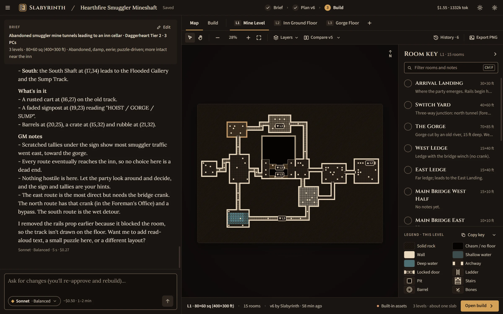

# Slabyrinth

[](https://github.com/mwaboff/slabyrinth/actions/workflows/ci.yml)
[](https://github.com/mwaboff/slabyrinth/releases/latest)
[](LICENSE)

Design TaleSpire maps by chatting with Claude, review them as a 2D plan, and paste them into the game as slabs.



Slabyrinth is a free, open-source desktop app for Windows and Linux. Website: <https://slabyrinth.aboff.com/>

## Download and install

Download the latest version from the [Releases page](https://github.com/mwaboff/slabyrinth/releases/latest).

| You want                       | Download                           |
| ------------------------------ | ---------------------------------- |
| Windows, installed             | `Slabyrinth-Setup-x.y.z.exe`       |
| Windows, no install (portable) | `Slabyrinth-x.y.z-portable.exe`    |
| Linux                          | `Slabyrinth-x.y.z-x86_64.AppImage` |

The builds are not code-signed yet, so your system warns you the first time you run one.

**Windows:** SmartScreen says "Windows protected your PC". Click **More info**, check that the file name matches what you downloaded, then click **Run anyway**.

**Linux:** make the AppImage executable, then run it.

```bash
chmod +x Slabyrinth-*.AppImage
./Slabyrinth-*.AppImage
```

AppImages need FUSE 2: install `libfuse2` (Ubuntu 22.04) or `libfuse2t64` (Ubuntu 24.04 and later). Without it, run `./Slabyrinth-*.AppImage --appimage-extract-and-run`.

## What you need

- **An Anthropic API key.** Slabyrinth chats with Claude using your own key, and Anthropic bills you for that usage. The cost varies from map to map: it depends on the map's size, the Claude model you choose and how many revisions you ask for. The app shows an estimate before each message and a running total, and you can set spending warnings in Settings.
- **TaleSpire**, to use what you build. Slabyrinth reads the asset library from your install. Without TaleSpire it falls back to a small built-in set of pieces: you can still design and export maps, but the newest tiles and props aren't available.

## How it works

1. **Describe** the place you want: a dungeon, a crypt, a tower. Claude asks a few questions, keeps a design brief, and draws a first plan.
2. **Review** the plan as a 2D map with a numbered room key, on one or several stacked levels. Change it by chatting ("make room 3 bigger") or directly on the map. Every change is a version you can undo, compare or restore.
3. **Build:** approve a version and Slabyrinth compiles it into TaleSpire slabs.
4. **Paste** into TaleSpire. **Copy & open TaleSpire** copies the slab and starts or focuses the game.

Also included:

- Each map is checked for playability: doors you can walk through, rooms you can reach, stairs with room to climb, furniture that doesn't block the way. Remaining issues are shown on the map.
- Choose the Claude model and effort for each conversation.
- Export the map as a PNG (with or without the room key) and the room key as Markdown.
- Dark and light themes, keyboard shortcuts, and autosave.

## Privacy and network

- **Network:** the app connects to `api.anthropic.com` to chat with Claude, and to GitHub for the update check. There is no telemetry and no account.
- **Your API key** is encrypted with your system's keychain (Electron `safeStorage`) and stored in the app data folder. It is only ever sent to `api.anthropic.com`, and never written to map files or logs. On Linux without a keyring, the key is kept in memory for the session unless you choose to store it with weaker protection.
- **Update check:** at most once a day the app sends one anonymous request to `api.github.com` for this repository's latest release. It carries no key, no map data and no identifiers. If a newer version exists, you see an "Update available" notice that links to its release page. Nothing is downloaded or installed for you. Turn the check off in **Settings ▸ About** ("Check for updates automatically").
- **Maps** are saved as one `.slabyrinth` file per map in `Documents/Slabyrinth` (you can change the folder in Settings). They are plain JSON, autosaved with crash-safe writes, and the previous good copy is kept as `<map>.slabyrinth.bak`.
- **App data** lives in `%APPDATA%\Slabyrinth` on Windows and `~/.config/Slabyrinth` on Linux: settings, the encrypted key, the asset library read from TaleSpire, custom palettes and logs. **Help ▸ Open data folder** opens it.
- **TaleSpire** is only ever read, never modified. To launch it, the app uses Steam.

## Known limitations

- Windows and Linux (x64) only.
- Claude is the only supported chat provider.
- Large maps that don't fit in one slab are split into a few, which you paste one after another using the alignment markers Slabyrinth adds.
- A few placement details are correct by calculation but not yet confirmed in game, such as door-handle sides on east and west walls and water surface height.
- Slab-count estimates near the size limit can be one too high.
- No automatic updates: the app tells you about a new version, and you download it yourself.

Not yet: other chat providers (such as LM Studio), importing existing slabs as stamps.

## Development

You need Git and Node.js 26 (see [`.nvmrc`](.nvmrc)) with its bundled npm. The repository uses npm workspaces with a single lockfile.

```bash
npm ci
node node_modules/electron/install.js   # npm ci doesn't fetch the Electron binary
npm run dev                             # run the app with hot reload
```

| Command             | What it does                                                  |
| ------------------- | ------------------------------------------------------------- |
| `npm test`          | Unit tests (Vitest) for all workspaces                        |
| `npm run test:e2e`  | Builds a test bundle and runs the Playwright end-to-end tests |
| `npm run lint`      | ESLint                                                        |
| `npm run typecheck` | `tsc -b` across all projects                                  |
| `npm run format`    | Prettier                                                      |
| `npm run build`     | Compiles the packages and bundles the app                     |
| `npm run package`   | Unpacked app in `apps/desktop/release/`                       |
| `npm run dist`      | Installers for the current OS in `apps/desktop/release/`      |

On a Linux machine without a display, run the end-to-end tests under `xvfb-run -a`. In development, the app also accepts an API key from the `ANTHROPIC_API_KEY` environment variable.

Repository layout:

- `packages/core`: the map plan, validation, compiler and slab codec (pure TypeScript, no Electron).
- `packages/render-canvas`: the 2D map renderer, shared by the map view and PNG export.
- `apps/desktop`: the Electron app (main process, conversation engine, React UI, end-to-end tests).
- `docs/`: design documents and contracts. `data/`: test slabs and reference data. `site/`: the website.

Before contributing, read [CONTRIBUTING.md](CONTRIBUTING.md), [docs/decisions.md](docs/decisions.md) and [docs/architecture.md](docs/architecture.md). Test and development modes (the fake engine, smoke runs) and custom palette files are described in [docs/architecture.md §7.6](docs/architecture.md#76-development-and-test-modes). To publish a release, follow [docs/releasing.md](docs/releasing.md).

## Licence and credits

Copyright © 2026 Michael Aboff. Released under the [MIT licence](LICENSE).

- The app's fonts, [Cinzel](https://fonts.google.com/specimen/Cinzel), [Lora](https://fonts.google.com/specimen/Lora) and [Source Sans 3](https://fonts.google.com/specimen/Source+Sans+3), are bundled through Fontsource under the SIL Open Font License 1.1.
- Two slab test vectors come from [TaleSpire.Slab](https://github.com/svenboulanger/TaleSpire.Slab) by Sven Boulanger (MIT). See [data/THIRD-PARTY.md](data/THIRD-PARTY.md).

Slabyrinth is an unofficial fan-made tool. It is not affiliated with, endorsed by or sponsored by Bouncyrock Entertainment (makers of TaleSpire) or Anthropic (makers of Claude). TaleSpire and Claude are trademarks of their respective owners. Slabyrinth does not include or redistribute TaleSpire's models, textures or asset catalog: its built-in palettes list only the ids, names and sizes of the pieces they use, and the full asset library is read from your own TaleSpire install.
